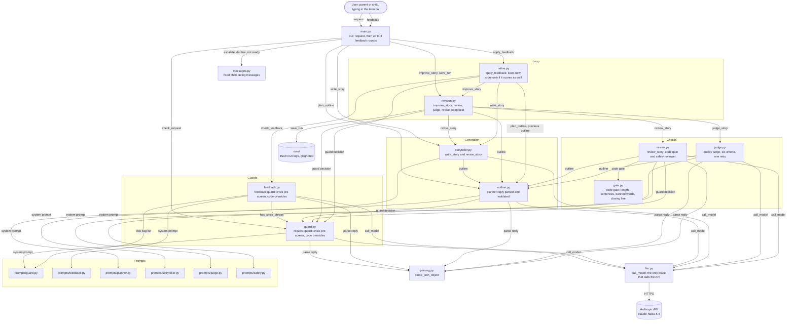

# Bedtime Story Agent

A terminal app that turns a bedtime-story request into a story for children aged 5 to 10. It uses Anthropic's Claude Haiku 5.5 (`claude-haiku-5-5`), and every story is checked for safety before a child sees it.

This is a take-home project for the Hippocratic AI forward-deployed engineer role. The assignment brief is in [ASSIGNMENT.md](ASSIGNMENT.md).

## What it does

1. **Request guard.** Routes each request to one of four outcomes: a story, a gentle version of a scary or sad story, a kind decline, or escalation to a trusted adult when a child may be in danger.
2. **Planner.** Writes a five-beat outline: setup, gentle want, small obstacle, kind solution, and calm wind-down.
3. **Storyteller.** Writes the story from the outline, following a style sheet for ages 5 to 10.
4. **Review and judge.** Each draft passes a code gate and a safety reviewer. A draft that passes is scored by a quality judge, and it is revised up to two times until it scores 8 or higher.
5. **Feedback.** After the story, you can ask for up to three changes. Each change goes through its own guard. The new version replaces the old one only if it passes review and scores at least as high.

## Setup

You need Python 3.10 or newer (developed on 3.12) and an Anthropic API key.

```bash
python3 -m venv .venv
.venv/bin/pip install -r requirements.txt
cp .env.example .env
```

Open `.env` and replace the placeholder with your key. Never commit `.env`. It is gitignored.

## Run

```bash
.venv/bin/python main.py
```

Type a request, such as `A story about a dragon who is scared of the dark.` When the story appears, type a change, or press Enter to finish.

## Tests

The unit tests stub the model, so they make no live calls. The placeholder key makes any call the tests missed fail without spending money.

```bash
ANTHROPIC_API_KEY=offline-test-key .venv/bin/python -m unittest discover -s tests
```

## Evals

The eval set has 44 cases: 32 story requests and 12 feedback changes. Each case is routed through the live guard or feedback guard. About 20 are safety-critical, and the eval reports unsafe leaks and missed escalations separately.

```bash
.venv/bin/python -m evals.run_evals
```

Add `--with-stories 3` to also run the full pipeline for three benign requests. That costs about ten model calls per story. Results are saved to `runs/`.

## Examples

These examples show real model outputs. They are generated by [evals/make_examples.py](evals/make_examples.py), so a new run will produce different text. Run `.venv/bin/python -m evals.make_examples` to regenerate them all, or add `review` to regenerate only example 4.

- [examples/01-gentle-dragon.md](examples/01-gentle-dragon.md): the gentle route, with the judge's scores. The draft passed on the first round, so there is no judge-driven revision here.
- [examples/04-review-revision.md](examples/04-review-revision.md): a first draft that failed review, and the revised draft that passed. This is the only revision in the examples.
- [examples/02-feedback-longer.md](examples/02-feedback-longer.md): one change applied, with keep-or-revert.
- [examples/03-safety-routes.md](examples/03-safety-routes.md): what a child sees on escalation and on decline.

## Architecture



The full diagram and the reading notes are in [docs/block-diagram.md](docs/block-diagram.md) and docs/block-diagram.png.

## Project layout

| Path | Purpose |
|---|---|
| `main.py` | Terminal app: request, then up to three feedback rounds |
| `guard.py`, `feedback.py` | Request guard and feedback guard, with crisis pre-screens and code overrides |
| `outline.py`, `storyteller.py` | Planner output and validation, and story writing and revision |
| `review.py`, `gate.py`, `judge.py` | Review (code gate and safety reviewer) and quality judge |
| `revision.py`, `refine.py` | Revision loop and feedback with keep-or-revert |
| `llm.py`, `parsing.py`, `messages.py` | The one place that calls the API, JSON parsing, and fixed child-facing messages |
| `prompts/` | All prompt text, one module per agent |
| `evals/`, `tests/`, `docs/`, `examples/` | Evals, unit tests, the diagram, and example runs |

## Design decisions

- **Layered safety.** Each layer can stop a story, and no layer can overrule another. The order is: a crisis pre-screen before any model call, the guard's routes, code overrides for the worst risk flags, the safety reviewer, and the deterministic code gate. The quality judge runs only after a draft passes both checks.
- **Fail closed.** An unreadable guard, feedback, or safety reply declines or fails the story. A reply cut off at the token limit raises an error. A child never sees a story that failed review, and the child sees only fixed messages.
- **The outline is the contract.** The planner writes five beats, the storyteller follows them, and the judge checks adherence. Feedback edits the outline, and the story is rewritten from it.
- **Code computes scores.** The judge gives six criterion scores, and the overall score is their mean, computed in code. The model never sets it.
- **Keep-or-revert.** A changed story replaces the old one only if it passes review and scores at least as high. Otherwise the old story stays, and the child is told why.
- **Prompts are separate from code.** Prompt text lives in `prompts/`. The category and risk-flag lists are defined once and used by both the prompts and the validation code.
- **Logs stay out of the child's view.** Developer logs go to stderr. Each run is saved as JSON in `runs/` for review.
- **Inspired by Polaris, not copied.** Hippocratic AI describes its Polaris models as using specialist supervisors, escalation to nurses, and clinical deference. I borrowed those patterns: specialist checks, escalation, staying within scope, and measured results. I did not copy an architecture, since their public page doesn't describe how the supervisors interact.

## Limits

- **Not a medical product.** This is a children's story generator. It borrows safety-engineering habits from clinical AI, but it is not a clinical system and needs supervision before real use.
- **The crisis keyword list is short.** It catches clear disclosures such as "hits me" or "kill myself." The model catches the rest, and it can miss some.
- **The eval set overlaps with the prompts.** Several cases match examples used while writing the prompts. A passing score shows that routing works on these cases, not that it generalizes. A held-out set is the next step.
- **The judge is not calibrated.** Its scores come from a model and have not been checked against human ratings.
- **Keep-or-revert is strict.** A score difference of 0.2 can reject a change the user asked for. A tolerance band is a likely improvement.
- **The judge rarely triggers a revision.** In five fresh test requests, four passed on the first draft with scores of 8.3 to 8.8. Revisions in practice come mostly from review failures. The judge's revision path has been tested with stubs, and in one earlier run it moved a score from 7.5 to 8.0.
- **"Make it longer" is not reliable.** One run went from 339 to 438 words, and another went from 372 to 331 words. In both runs, keep-or-revert rejected the new version because its judge score was lower, so the user never saw the change.
- **Emergency numbers are US numbers.** The escalation message gives 911 and 988. Change `messages.py` for another country.
- **No brand list in the code.** The safety reviewer catches brand names, but a deterministic list would be cheaper.
- **Children's text is stored locally.** `runs/` holds requests and stories as JSON. It is gitignored. Delete it when you are done.
- **Cost.** A full story takes about ten model calls. A full guard eval takes about 40 calls.

## Next steps

See the draft note in the docstring at the top of [main.py](main.py).
