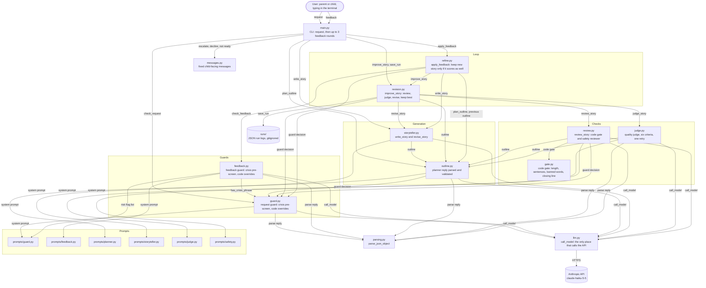

# Block diagram

This diagram shows what happens at runtime and which module does each job. Every arrow matches a call or an import in the code. Type-only imports, such as `GuardResult` and `Outline` used only in annotations, are drawn only where the module also uses the data at runtime.

## Reading the diagram

- **One request, start to finish.** `main.py` runs the guard first. An escalate or decline route ends with a fixed message, and no story is written. A story route goes to the planner, then the storyteller, then the revision loop. `save_run` writes every round to `runs/`.
- **The revision loop.** Each draft is reviewed first. `review_story` runs the code gate (`gate.py`) and the safety reviewer (`prompts/safety.py`). Only a draft that passes review is judged. A score of 8 or higher ends the loop. Otherwise the storyteller revises the draft using the review problems and judge notes, for at most two revisions.
- **Feedback.** Each change goes through `check_feedback` first. An applied change is re-planned from the previous outline, written, and run through the same loop. The new story replaces the old one only if it passes review and scores at least as high.
- **Safety layers.** The crisis phrase pre-screen runs before any model call. The code gate and code overrides cannot be argued with. The safety reviewer is strict, and any issue it lists fails the story.
- **One place for the API.** Every model call goes through `llm.py`, so the model name, the key handling, and the cut-off check live in one file.

## Not drawn

- **Evals.** `evals/run_evals.py` calls the guard and feedback guard, and optionally the full story pipeline. It scores the results with `evals/scoring.py` and reads cases from `evals/cases.jsonl`.
- **Tests.** `tests/` stubs the model, so the unit tests make no live calls. They check the logic in every module except `storyteller.py`, whose functions are stubbed rather than checked directly. The storyteller is covered only through the live runs.
- **Environment.** `llm.py` reads `ANTHROPIC_API_KEY` from `.env`, through python-dotenv.
